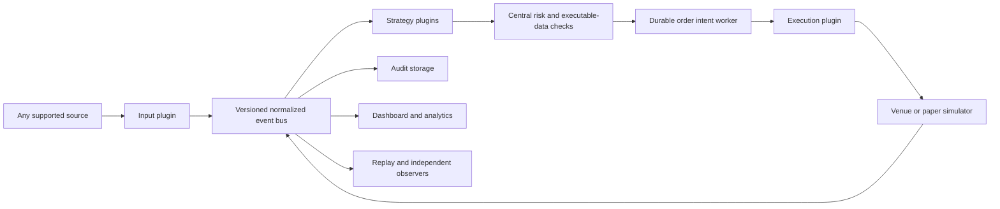

# EV Platform

A local Windows sports-market intelligence platform with a working deterministic
demo, simulated execution, a React dashboard, typed plugins, and native API
transport implementations.

**The demo and paper path is runnable now without credentials. Live unattended
trading is not release-ready and remains blocked.** Reviewed market mappings,
live fees, order lifecycle behavior, and private execution/settlement
reconciliation still need validation. Supplying a key
does not arm real-money trading. See [implementation status](docs/IMPLEMENTATION_STATUS.md).

Personal Kalshi production account reads and order-book streaming, plus personal
Polymarket US account and market streams, have passed actual connection checks.
The Polymarket US plugin is monitoring only; automated orders and cancellations
are unsupported. Credentials stay in the protected backend environment. See
[connection evidence and limitations](docs/PROVIDER_PROTOCOLS.md).

Provider Center remembers external feed and account-monitor enable settings
across restarts. Trading activation remains separate and starts paused.

Provider Center also shows the last message age, received-message and market-payload
counts, mapped quotes, quarantined quotes, and monitored books when an adapter
reports them. These are transport diagnostics. A connected socket or recent
message does not establish that an individual quote is current or active.

The supplied 11 sport/market weighting profiles are available as provisional
research settings, with the first four prop profiles selected for initial testing.
They use power devig plus proportional sensitivity checks, distinct-book and
anchor requirements, and exact source freshness policies. Missing freshness or
status evidence blocks execution. See [reference profiles](docs/REFERENCE_MODEL.md)
and [the source review](docs/BOOK_WEIGHT_RESEARCH.md); these are not fitted or
proven-profitable weights.

The optional [winner-only binary pricing policy](docs/WINNER_ONLY_BINARY.md)
estimates EV conditional on a normal WIN/LOSS result while keeping exceptional
settlement accounting separate. It is disabled by default and does not relax
source freshness or live authorization.

## Start on Windows

Prerequisites: Python 3.12+, Node.js 22.12+ or a compatible current LTS, PowerShell,
and internet access for the initial dependency installation. No Docker, Redis,
PostgreSQL, paid subscriptions, or API keys are needed for the demo.

From this folder:

```powershell
powershell -ExecutionPolicy Bypass -File .\setup_windows.ps1
powershell -ExecutionPolicy Bypass -File .\start_demo.ps1
```

Open **http://127.0.0.1:8001**. Port 8000 was already occupied on the development PC.
The backend serves the built dashboard and WebSocket on the same local port.
Scripts install missing dependencies/build assets when necessary. `-ExecutionPolicy
Bypass` applies to this invocation; it does not alter the machine-wide policy.

The demo starts with automatic trading **off**. Enable **paper automation** in the
dashboard to generate simulated orders, or stop the demo and explicitly start:

```powershell
.\stop_local.ps1 -Port 8001
.\start_paper.ps1 -AutoTrade
```

`start_paper.ps1` without `-AutoTrade` keeps execution off. The paper labels
`kalshi_paper`, `novig_paper`, and `prophetx_paper` are **synthetic $1-contract
scenarios**, not replicas of those exchanges' fees or native units.

To open a separate paper workspace with connected real feeds and **no sample
odds**, run this from PowerShell:

```powershell
powershell -NoProfile -ExecutionPolicy Bypass -File .\start_live_paper.ps1
```

The launcher stops a paused demo instance on port 8001, opens
`data/live-paper.db`, and restores its enabled input and account-monitor
plugins. It never copies synthetic trade history or trading authorization.
Use this launcher to resume a real-feed paper session. It checks the recorded
database path before reusing a running paper process; a paper process started
against the default demo database is moved to `data/live-paper.db` after its
open orders are checked. Existing database files are preserved.
It also runs the same `setup_live_inputs.ps1` feed/profile setup used by
`start_native.ps1`; there is one source of sportsbook weights and feed scopes.
It configures four priority sports across a broad Parlay prop stream, a
separate game-line stream, and scheduled REST discovery, then enables paper
automation only after a complete game-board baseline arrives. Pass `-Paused`
to leave paper orders paused.
The game-line stream requests the provider's complete-board
shape and records which sports actually receive a confirmed complete baseline.
If the paper workspace still uses legacy equal weights, this command also
loads the supplied research profiles without authorizing native execution.
This configuration uses the backend-only Parlay key. It makes an estimated 24
REST credits per 15-minute cycle when all four sports are subscribed; check
the provider's actual usage headers and account balance in Provider Center.
By itself, the launcher enables **simulated paper automation** unless you pass
`-Paused` or an emergency stop is active. The paper-only strategy consumes the existing Parlay
game-board stream and compares complete, pregame, two-sided moneylines from
distinct sportsbooks. It excludes the quoted target book from its own fair
estimate, requires an anchor specified by the selected profile (Pinnacle or
Circa for NBA/NFL mainlines) plus another fresh book, checks both power and
proportional devigging, and records positive and negative paper signals. A
qualifying signal passes the central risk engine into the local simulator.
The same live-paper workspace also enables the metered Oddize NBA moneyline
feed as a supplemental reference. A paper-only matcher links exact known team
codes and a unique game within a 15-minute scheduled-start difference to the
Parlay board. It preserves Oddize's source observation time, deduplicates the
same sportsbook across vendors, and excludes quotes older than 10 minutes
from paper EV. Matched but old quotes remain visible with their age in Market
Detail. Oddize's Developer allowance paces this REST feed to roughly hourly
NBA snapshots; it is not a live stream or verified native trading evidence.
For this paper experiment the complete Parlay game board may retain a price
whose `last_update` is up to 10 minutes old. Its source timestamp stays intact.
Opposing moneyline sides must have price-change clocks within 30 seconds of
each other; a retained side cannot be paired with a much newer opposing side.
The paper strategy additionally requires the provider heartbeat to show that
the **book** was polled within three minutes, then constructs short-lived
simulated capacity. A book poll does not establish that this exact quote is
currently offered. Production pricing continues to require its separate
reviewed observation, market-status and TTL evidence.
No additional Parlay socket is opened for the paper consumer. Native execution
stays off. The paper offer is the actual Parlay quoted price converted to a
$1-payout equivalent; its available quantity and fill are **simulated**. A
complete provider baseline and a recent `last_update` do not prove the book
would accept a wager, that its displayed line is still active upstream, or that
its settlement is equivalent to a prediction-market contract. These paper
results must not be used as validated live-order evidence. Player props and
exchange books remain excluded from this assumed-price paper route; unverified
real quotes stay quarantined for native trading.
The paper comparison uses the sportsbook's devigged percentage directly; it
does not apply a guessed void or settlement haircut. Live Opportunities and
Market Detail show the same percentage as American and decimal fair-odds
equivalents (`decimal = 1 / probability`). For example, a 60% fair estimate
displays about -150 / 1.67 decimal, while a 55-cent hypothetical offer displays
about -122 / 1.82 decimal. The paper EV is 5 cents per $1 payout before any
applicable fees; the displayed net EV/ROI uses the configured fee calculation.
These odds labels are a change of units, not a new price model or a verified
exchange comparison.
Running the launcher again retains its separate order ledger and applies the
shared feed/profile settings. `start_native.ps1 -Environment production`
applies the same feed/profile setup to its own paused workspace. This does not
make the paper-only hypothetical sportsbook offer a native exchange order:
real bets still require exact exchange mappings, quote-status and settlement
evidence, account preflight, and the live activation gates. A complete provider
game board is only a scoped baseline; it does not verify each retained price is
still offered or that an exchange contract has equivalent settlement rules.
Both workspaces block overlapping events and players and display a $5 unit.
Owls and OddsPapi are optional reference adapters. With a local
`ODDSPAPI_API_KEY`, shared setup also enables a quota-capped, pregame NBA
OddsPapi research feed. The current free account has no in-play entitlement;
the real-order gate still requires verified market mappings and fresh quotes.
The paper launcher omits a duplicate production ProphetX monitor so its API
key is used by the paused native workspace only. ProphetX limits simultaneous
sessions per key, and reconnecting the paper dashboard must not consume a
second session slot. The paper data path remains Parlay plus Oddize.
Paper stakes stay capped at $5 because the simulator has no account cash.
The paused native workspace stores quarter-Kelly sizing with authenticated
available-cash limits instead of a fixed dollar cap. Its independent account
checks and live stake authorization still block real orders until validated.

Useful commands:

```powershell
.\start_demo.ps1 -Port 8002 -NoBrowser -Background
.\stop_local.ps1 -Port 8002
.\run_tests.ps1
.\.venv\Scripts\python.exe scripts\benchmark.py --seconds 15
```

The hidden backend keeps running if the waiting PowerShell is interrupted.
Use `stop_local.ps1` for graceful cancellation, audit drain, and shutdown.
The script verifies the recorded executable and command before stopping a process.
An existing listener is not overwritten or terminated.

Native sandbox preparation starts in a separate database with automation off:

```powershell
.\start_native.ps1 -Environment sandbox -Port 8002
.\.venv\Scripts\python.exe scripts\check_live_readiness.py --url http://127.0.0.1:8002
```

The Trading page shows the launch blockers and a separate native order ledger.
The native route preserves fractional contracts, cent contracts, and USD stakes
with exact decimal cash accounting. Shared risk controls reserve exposure before
durable intent and never treat an acknowledgement as a fill. See
[the launch guide](docs/GO_LIVE.md) and [native accounting](docs/NATIVE_ACCOUNTING.md).
No startup script arms native trading.

Novig's production management key is separate from its trading-wallet key.
Run `.\setup_novig.ps1` for a read-only setup status. The
[Novig setup guide](docs/NOVIG_SETUP.md) covers protected key preparation,
owner-performed wallet opening/funding, and unknown-outcome recovery. Preparing
or exporting credentials never enables betting.

The existing Novig Paper keys have also exercised a genuine play-money IOC
through the durable native OMS and fill reconciliation. See the
[Paper connector evidence](docs/NOVIG_PAPER_PROBE.md) for the exact scope and
the remaining settlement and production checks. Novig account probes use the
same-environment management key only to verify the trading key's permission
and local signer fingerprint; an unverified scope cannot become spendable cash.

For frontend development, run `npm.cmd run dev` in `frontend/`; Vite proxies to
8001. Set `EV_API_TARGET=http://127.0.0.1:8002` for another backend port.

## What the demo does

- Streams nine sample moneyline, total, and player-prop markets across NBA,
  NFL, and NHL labels. The schedule is illustrative, not a claim about real games.
- Supplies four independent provider observations, including two observations of
  the same Pinnacle quote. The model counts Pinnacle once.
- Supplies 27 synthetic venue books with positive and negative fee-adjusted EV.
- Periodically simulates stale Circa quotes, a suspended market, and an invalid
  sequence state that recovers through a snapshot.
- Applies exact event/player/statistic/threshold/period/settlement matching.
- Uses proportional or power devigging, per-market configuration, required
  references, freshness, disagreement limits, and explicit `NO SIGNAL` states.
- Checks fresh executable best-price depth, fees, duplicate orders, stake,
  event/player/venue/correlated exposure, an optional daily realized-loss stop, and a kill switch.
- Locks each position family across venues and strategies, including alternate
  lines. Filled, partial and unknown positions remain reserved until settlement.
  Submission caps and monetary limits are rechecked after durable writes.
- Persists intent before simulated submission, acknowledges separately from
  fills, produces partial fills, supports cancellation, and recovers on restart.
- Shows source clocks, quote age, books, model details, orders, positions,
  plugin status/configuration, latency samples, and audit events.
- Records generated signal updates even while trading is paused, including
  negative opportunities and NO SIGNAL transitions. Detailed per-tick records
  have a six-hour retention window. Compact signal episodes, cumulative decision
  and transition counts, and explicitly hypothetical grades remain available.

Synthetic paper fills are intentionally conservative and simplified. They are
not an estimate of live queue position, matching probability, adverse selection,
or profitability. No profitability claim follows from a successful test.

## Architecture



Core pricing and risk use in-memory market dictionaries. Source changes recalculate
only their affected market. A deadline heap handles freshness expiration without
full-board pricing sweeps. Market discovery and identity mapping happen outside
the order path.

SQLite runs in WAL/FULL mode behind an asynchronous writer. Audit writes are
batched. **Durable intent is a necessary disk barrier before transmission**; it
is isolated from pricing and measured separately. It is not honest to promise
both durable-before-send and zero disk involvement in total order latency.

Input, strategy, execution, and observer contracts are independent. Non-odds
events include game state and player projections. Additional schema versions and
explicit migrations preserve older contracts. Installed packages register through
the `evplatform.plugins` entry-point group. Dashboard screens use plugin manifests
and configuration schemas instead of provider-specific controls.

Python plugins are trusted installed code, not a security sandbox. Failure
isolation catches adapter/strategy failures and trips central safety gates; it
does not contain malicious Python code. Install reviewed plugins only.

See [HOW_TO_ADD_A_PROVIDER.md](HOW_TO_ADD_A_PROVIDER.md) for concrete extensions,
including WebSocket, SSE, custom strategies, and execution venues.

## Credentials and enabling real reference data

`setup_windows.ps1` creates `.env` from `.env.example` only when no `.env` exists.
The command-line launcher reads it into the backend environment. Keys never appear
in public configuration, dashboard responses, or auth URLs in logs.

The provider adapters and native transports were implemented against official
documentation. Their exact scope and evidence are in:

- [Provider protocols and limitations](docs/PROVIDER_PROTOCOLS.md)
- [Native venue protocols and limitations](docs/VENUE_PROTOCOLS.md)
- [Oddize free REST setup and actual validation](docs/ODDIZE.md)
- [Signal history, grading and safety controls](docs/SIGNAL_TRACKING.md)
- [Native launch checks and configuration](docs/GO_LIVE.md)
- [Multi-book consensus research and limitations](docs/MULTI_BOOK_CONSENSUS.md)

Every live provider is disabled by default and independent of the demo. Enabling
a provider with no credentials reports a blocked state rather than crashing or
substituting mock data.

### When the Parlay WebSocket key arrives

1. Put `PARLAY_API_KEY=your_actual_key` in local `.env`. Do not paste it into the
   dashboard. Stop and restart the backend so it reads the changed environment.
2. Keep automatic trading off. In **Provider Center**, open the `parlay_ws` config.
3. Use actual entitled sport and market keys. A game-plus-props example is:

   ```json
   {
     "sports": ["basketball_nba"],
     "bookmakers": ["pinnacle", "fanduel", "draftkings"],
     "markets": ["h2h", "totals", "player_points"],
     "stream_kinds": ["game", "prop"],
     "account_tier": "business",
     "session_request_budget": 1000
   }
   ```

   Merge these values into the displayed full config and save. Select the actual
   account tier; setting a tier name cannot bypass server entitlement checks.
4. Enable `parlay_ws`. Confirm authenticated/streaming health and received messages.
   Missing or insufficient entitlement leaves streaming blocked. An unverified
   source timestamp does not become current because a heartbeat arrived.
5. Inspect quarantine identities from `GET /api/state` → `quarantine`. Verify the
   event, athlete, exact line, outcomes, period, and rules. Add reviewed entries
   to `data/verified_mappings.json` using
   [the mapping format](docs/PROVIDER_PROTOCOLS.md#verified-mapping-files).
6. Disable and re-enable the provider to reload mappings. Confirm real observations
   have `synthetic: false`, correct source times, and the expected independent
   bookmaker count before using them as references.

Owls/OddsPapi use their separate environment variables and provider config forms.
Bookmaker-specific live/prop permissions are checked where documented. Discovery
coverage is account dependent.

For native venue keys, `.env.example` includes the extra signing key paths and
ProphetX secret required by current documentation. Configure native monitors for
the correct sandbox/production environment. The Trading desk's **Live setup**
panel shows each configured account, real versus synthetic coverage, the saved
limits, and the remaining launch checks. Its final enable control is available
only in a reviewed production workspace after every current check passes.
`EV_LIVE_ENABLED=true` alone does not bypass the account-bound launch profile,
reviewed mappings/fees, current synchronized feeds, explicit limits, or genuine
lifecycle and settlement evidence. The current installation is not ready for
real orders; see [the launch guide](docs/GO_LIVE.md).

The saved owner policy now uses **quarter Kelly**, with **$5 = 1 reporting unit**
and no fixed dollar cap per bet. Each account's verified available cash funds
only that account, after pending reservations; overlapping game/player bets
remain blocked across venues. Orders below verified native minimums are skipped.
The policy stays an unapplied draft until launch evidence passes. See
[stake sizing](docs/STAKE_SIZING.md). The Trading desk also offers a separate
read-only **Refresh balances** view; reported balances are not spendable-cash
certification or permission to trade.

Current actual checks and repeatable evidence tools are documented in
[market review](docs/MARKET_EVIDENCE_WORKFLOW.md),
[source freshness](docs/FRESHNESS_EVIDENCE.md), and
[native lifecycle evidence](docs/NATIVE_LIFECYCLE_EVIDENCE.md).

Book weights are configurable, not learned or validated automatically. The
current default is equal weighting after removing each book's margin, requiring
two distinct books and fresh quotes. See [the reference model](docs/REFERENCE_MODEL.md)
and [the NBA settlement comparison](docs/NBA_SETTLEMENT_EVIDENCE.md) before
treating sportsbook and exchange prices as interchangeable.

## Data, replay, and recovery

`data/evplatform.db` contains audit events, order intents/states, fills, and
configuration. Never delete an active database or its WAL/SHM files. Stop the app
before copying the database for a backup.

The app sets a 3 GiB SQLite cap on each open operational database. New
signal snapshots are losslessly compressed while their market JSON remains
queryable; historical snapshots can be migrated offline. A
background task removes raw quote/event detail, per-tick signal snapshots, and
transition detail older than six hours. It keeps order/fill/settlement events,
all order and fill tables, signal results, compact signal episodes, and cumulative
signal counts. The retention task works outside pricing and order routing.
New databases use SQLite full auto-vacuum and a bounded WAL. Existing databases
need one offline compaction to reclaim previously occupied disk space:

```powershell
.\stop_local.ps1 -Port 8001
.\.venv\Scripts\python.exe scripts\maintain_storage.py --database data\live-paper.db --compress-signals --compact
.\start_live_paper.ps1 -Port 8001 -NoBrowser
```

Only run that command on the database belonging to the stopped service. It
preserves financial history and compact signal history. A separate inactive demo
database can still consume disk; inspect its orders, fills, settlements, and
real-market episodes before removing it. The folder-wide size can exceed 10 GiB
if multiple databases or old test artifacts accumulate, so inspect `data` when
adding another long-running workspace.
`clean_workspace.ps1` reports the size of disposable old pytest directories and
benchmark databases without changing anything. Run `powershell -NoProfile
-ExecutionPolicy Bypass -File .\clean_workspace.ps1 -Apply -MinAgeHours 12` to
remove only those files after tests have stopped. `run_tests.ps1` also cleans
these old test artifacts after a successful run. It never selects operational
databases or account evidence. The report includes the total workspace size and
whether it is below 10 GiB.
For a large stopped historical database, add `--fast-offline` to prune in larger
committed ranges before compaction; an interrupted run can be repeated safely.
If pruning finished but compaction was interrupted, rerun with `--compact-only`
after confirming the service is still stopped.

`fixtures/demo_replay.jsonl` contains fixed-clock synthetic frames including stale,
suspended, sequence-gap, and recovery cases. Regenerate it with:

```powershell
.\.venv\Scripts\python.exe scripts\create_replay.py
```

`plugins.replay.replay_jsonl` publishes those same versioned events; it never
advances old source timestamps. For offline valuation use the fixture's recorded
clock, as the replay tests do. Old historical fixtures are intentionally not
eligible for current live orders.

Confirmed fill IDs survive restart. Outstanding paper residuals are cancelled on
recovery; native unknown outcomes remain reserved until reconciliation. Automatic
trading is not persisted as a convenience preference. Safety stops are persisted.
An unclean shutdown requires an explicit kill-switch reset after inspecting state.
Restart using the same startup command, inspect orders and source health, then
explicitly re-enable paper automation.

Paper settlement accepts a typed `SettlementResult` through `POST
/api/paper/settle` (with `X-EV-Control: local`). It is idempotent, requires complete
outcome payouts and evidence, supports paper refunds/partial binary payouts, rejects
unresolved orders, releases settled exposure, and persists realized P&L. It is not
an automatic feed of real results. Native accounting uses its own durable ledger;
venue-specific settlement support and account-backed validation are listed in
[the venue guide](docs/VENUE_PROTOCOLS.md).

## Operating the PC

In Windows **Settings → System → Power & battery → Screen, sleep & hibernate
timeouts**, choose a plugged-in sleep policy appropriate for your session.
The software does not change system power settings. Locking the screen is
different from sleeping the computer. Network loss suspends freshness-dependent
signals. The application cannot run while the PC is asleep or powered off.

The API binds to loopback only. Browser writes require a local origin and explicit
control header; the server does not enable cross-origin control. It is intended
for one trusted Windows account, not a public multi-user service.

## Validation and limits

`run_tests.ps1` reuses a project-local temporary directory because this Windows
profile denied pytest access to its default Temp tree. It runs Python tests,
statement coverage, TypeScript checking, and the Vite production build.
An upstream Starlette/httpx deprecation warning does not fail these checks.

Measured results are in [VALIDATION.md](docs/VALIDATION.md). Source quote age,
HTTP roundtrip, local receipt-to-calculation time, internal processing, durable
intent delay, acknowledgements, and simulated fills have separate meanings.
p95 is shown after 20 samples and p99 after 100; samples are bounded to 10,000.

Missing functionality is listed explicitly in
[IMPLEMENTATION_STATUS.md](docs/IMPLEMENTATION_STATUS.md). The platform includes
extension points for arbitrage, middles, steam, external models and unusual
contracts; those strategies and payout models are not falsely presented as
implemented.

To check which books currently appear in Parlay's NBA game and prop coverage
without spending odds credits, run:

```powershell
.\.venv\Scripts\python.exe scripts\check_parlay_coverage.py
```

Coverage counts do not establish that an individual quote is active or eligible
for live execution.
