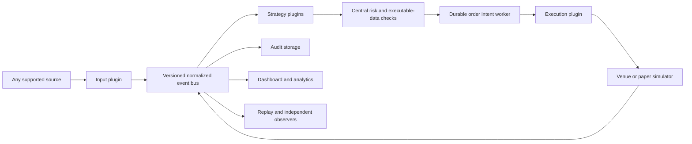

# EV Platform

A local Windows sports-market intelligence platform with a working deterministic
demo, simulated execution, a React dashboard, typed plugins, and native API
transport implementations.

**The demo and paper path is runnable now without credentials. Live unattended
trading is not release-ready and remains blocked.** Reviewed market mappings,
live fees, order lifecycle behavior, and private execution/settlement
reconciliation still need validation. Supplying a key
does not arm real-money trading. See [implementation status](docs/IMPLEMENTATION_STATUS.md).

Personal Kalshi production account reads and order-book streaming, plus personal
Polymarket US account and market streams, have passed actual connection checks.
The Polymarket US plugin is monitoring only; automated orders and cancellations
are unsupported. Credentials stay in the protected backend environment. See
[connection evidence and limitations](docs/PROVIDER_PROTOCOLS.md).

Provider Center remembers external feed and account-monitor enable settings
across restarts. Trading activation remains separate and starts paused.

## Start on Windows

Prerequisites: Python 3.12+, Node.js 22.12+ or a compatible current LTS, PowerShell,
and internet access for the initial dependency installation. No Docker, Redis,
PostgreSQL, paid subscriptions, or API keys are needed for the demo.

From this folder:

```powershell
powershell -ExecutionPolicy Bypass -File .\setup_windows.ps1
powershell -ExecutionPolicy Bypass -File .\start_demo.ps1
```

Open **http://127.0.0.1:8001**. Port 8000 was already occupied on the development PC.
The backend serves the built dashboard and WebSocket on the same local port.
Scripts install missing dependencies/build assets when necessary. `-ExecutionPolicy
Bypass` applies to this invocation; it does not alter the machine-wide policy.

The demo starts with automatic trading **off**. Enable **paper automation** in the
dashboard to generate simulated orders, or stop the demo and explicitly start:

```powershell
.\stop_local.ps1 -Port 8001
.\start_paper.ps1 -AutoTrade
```

`start_paper.ps1` without `-AutoTrade` keeps execution off. The paper labels
`kalshi_paper`, `novig_paper`, and `prophetx_paper` are **synthetic $1-contract
scenarios**, not replicas of those exchanges' fees or native units.

Useful commands:

```powershell
.\start_demo.ps1 -Port 8002 -NoBrowser -Background
.\stop_local.ps1 -Port 8002
.\run_tests.ps1
.\.venv\Scripts\python.exe scripts\benchmark.py --seconds 15
```

The hidden backend keeps running if the waiting PowerShell is interrupted.
Use `stop_local.ps1` for graceful cancellation, audit drain, and shutdown.
The script verifies the recorded executable and command before stopping a process.
An existing listener is not overwritten or terminated.

Native sandbox preparation starts in a separate database with automation off:

```powershell
.\start_native.ps1 -Environment sandbox -Port 8002
.\.venv\Scripts\python.exe scripts\check_live_readiness.py --url http://127.0.0.1:8002
```

The Trading page shows the launch blockers and a separate native order ledger.
The native route preserves fractional contracts, cent contracts, and USD stakes
with exact decimal cash accounting. Shared risk controls reserve exposure before
durable intent and never treat an acknowledgement as a fill. See
[the launch guide](docs/GO_LIVE.md) and [native accounting](docs/NATIVE_ACCOUNTING.md).
No startup script arms native trading.

For frontend development, run `npm.cmd run dev` in `frontend/`; Vite proxies to
8001. Set `EV_API_TARGET=http://127.0.0.1:8002` for another backend port.

## What the demo does

- Streams nine sample moneyline, total, and player-prop markets across NBA,
  NFL, and NHL labels. The schedule is illustrative, not a claim about real games.
- Supplies four independent provider observations, including two observations of
  the same Pinnacle quote. The model counts Pinnacle once.
- Supplies 27 synthetic venue books with positive and negative fee-adjusted EV.
- Periodically simulates stale Circa quotes, a suspended market, and an invalid
  sequence state that recovers through a snapshot.
- Applies exact event/player/statistic/threshold/period/settlement matching.
- Uses proportional or power devigging, per-market configuration, required
  references, freshness, disagreement limits, and explicit `NO SIGNAL` states.
- Checks fresh executable best-price depth, fees, duplicate orders, stake,
  event/player/venue/correlated exposure, daily realized loss, and a kill switch.
- Locks each position family across venues and strategies, including alternate
  lines. Filled, partial and unknown positions remain reserved until settlement.
  Submission caps and monetary limits are rechecked after durable writes.
- Persists intent before simulated submission, acknowledges separately from
  fills, produces partial fills, supports cancellation, and recovers on restart.
- Shows source clocks, quote age, books, model details, orders, positions,
  plugin status/configuration, latency samples, and audit events.
- Saves every generated signal update even while trading is paused, including
  negative opportunities and NO SIGNAL transitions. Performance shows permanent
  signal episodes and explicitly hypothetical grades from supplied results.

Synthetic paper fills are intentionally conservative and simplified. They are
not an estimate of live queue position, matching probability, adverse selection,
or profitability. No profitability claim follows from a successful test.

## Architecture



Core pricing and risk use in-memory market dictionaries. Source changes recalculate
only their affected market. A deadline heap handles freshness expiration without
full-board pricing sweeps. Market discovery and identity mapping happen outside
the order path.

SQLite runs in WAL/FULL mode behind an asynchronous writer. Audit writes are
batched. **Durable intent is a necessary disk barrier before transmission**; it
is isolated from pricing and measured separately. It is not honest to promise
both durable-before-send and zero disk involvement in total order latency.

Input, strategy, execution, and observer contracts are independent. Non-odds
events include game state and player projections. Additional schema versions and
explicit migrations preserve older contracts. Installed packages register through
the `evplatform.plugins` entry-point group. Dashboard screens use plugin manifests
and configuration schemas instead of provider-specific controls.

Python plugins are trusted installed code, not a security sandbox. Failure
isolation catches adapter/strategy failures and trips central safety gates; it
does not contain malicious Python code. Install reviewed plugins only.

See [HOW_TO_ADD_A_PROVIDER.md](HOW_TO_ADD_A_PROVIDER.md) for concrete extensions,
including WebSocket, SSE, custom strategies, and execution venues.

## Credentials and enabling real reference data

`setup_windows.ps1` creates `.env` from `.env.example` only when no `.env` exists.
The command-line launcher reads it into the backend environment. Keys never appear
in public configuration, dashboard responses, or auth URLs in logs.

The provider adapters and native transports were implemented against official
documentation. Their exact scope and evidence are in:

- [Provider protocols and limitations](docs/PROVIDER_PROTOCOLS.md)
- [Native venue protocols and limitations](docs/VENUE_PROTOCOLS.md)
- [Oddize free REST setup and actual validation](docs/ODDIZE.md)
- [Signal history, grading and safety controls](docs/SIGNAL_TRACKING.md)
- [Native launch checks and configuration](docs/GO_LIVE.md)

Every live provider is disabled by default and independent of the demo. Enabling
a provider with no credentials reports a blocked state rather than crashing or
substituting mock data.

### When the Parlay WebSocket key arrives

1. Put `PARLAY_API_KEY=your_actual_key` in local `.env`. Do not paste it into the
   dashboard. Stop and restart the backend so it reads the changed environment.
2. Keep automatic trading off. In **Provider Center**, open the `parlay_ws` config.
3. Use actual entitled sport and market keys. A game-plus-props example is:

   ```json
   {
     "sports": ["basketball_nba"],
     "bookmakers": ["pinnacle", "fanduel", "draftkings"],
     "markets": ["h2h", "totals", "player_points"],
     "stream_kinds": ["game", "prop"],
     "account_tier": "business",
     "session_request_budget": 1000
   }
   ```

   Merge these values into the displayed full config and save. Select the actual
   account tier; setting a tier name cannot bypass server entitlement checks.
4. Enable `parlay_ws`. Confirm authenticated/streaming health and received messages.
   Missing or insufficient entitlement leaves streaming blocked. An unverified
   source timestamp does not become current because a heartbeat arrived.
5. Inspect quarantine identities from `GET /api/state` → `quarantine`. Verify the
   event, athlete, exact line, outcomes, period, and rules. Add reviewed entries
   to `data/verified_mappings.json` using
   [the mapping format](docs/PROVIDER_PROTOCOLS.md#verified-mapping-files).
6. Disable and re-enable the provider to reload mappings. Confirm real observations
   have `synthetic: false`, correct source times, and the expected independent
   bookmaker count before using them as references.

Owls/OddsPapi use their separate environment variables and provider config forms.
Bookmaker-specific live/prop permissions are checked where documented. Discovery
coverage is account dependent.

For native venue keys, `.env.example` includes the extra signing key paths and
ProphetX secret required by current documentation. Configure native monitors for
the correct sandbox/production environment. **There is no one-click production
trading switch in this release.** `EV_LIVE_ENABLED=true` alone does not bypass the
account-bound launch profile, reviewed mappings/fees, current synchronized feeds,
explicit limits, or genuine lifecycle and settlement evidence.

## Data, replay, and recovery

`data/evplatform.db` contains audit events, order intents/states, fills, and
configuration. Never delete an active database or its WAL/SHM files. Stop the app
before copying the database for a backup.

`fixtures/demo_replay.jsonl` contains fixed-clock synthetic frames including stale,
suspended, sequence-gap, and recovery cases. Regenerate it with:

```powershell
.\.venv\Scripts\python.exe scripts\create_replay.py
```

`plugins.replay.replay_jsonl` publishes those same versioned events; it never
advances old source timestamps. For offline valuation use the fixture's recorded
clock, as the replay tests do. Old historical fixtures are intentionally not
eligible for current live orders.

Confirmed fill IDs survive restart. Outstanding paper residuals are cancelled on
recovery; native unknown outcomes remain reserved until reconciliation. Automatic
trading is not persisted as a convenience preference. Safety stops are persisted.
An unclean shutdown requires an explicit kill-switch reset after inspecting state.
Restart using the same startup command, inspect orders and source health, then
explicitly re-enable paper automation.

Paper settlement accepts a typed `SettlementResult` through `POST
/api/paper/settle` (with `X-EV-Control: local`). It is idempotent, requires complete
outcome payouts and evidence, supports paper refunds/partial binary payouts, rejects
unresolved orders, releases settled exposure, and persists realized P&L. It is not
an automatic feed of real results. Native accounting uses its own durable ledger;
venue-specific settlement support and account-backed validation are listed in
[the venue guide](docs/VENUE_PROTOCOLS.md).

## Operating the PC

In Windows **Settings → System → Power & battery → Screen, sleep & hibernate
timeouts**, choose a plugged-in sleep policy appropriate for your session.
The software does not change system power settings. Locking the screen is
different from sleeping the computer. Network loss suspends freshness-dependent
signals. The application cannot run while the PC is asleep or powered off.

The API binds to loopback only. Browser writes require a local origin and explicit
control header; the server does not enable cross-origin control. It is intended
for one trusted Windows account, not a public multi-user service.

## Validation and limits

`run_tests.ps1` uses a project-local temporary directory because this Windows
profile denied pytest access to its default Temp tree. It runs Python tests,
statement coverage, TypeScript checking, and the Vite production build.
An upstream Starlette/httpx deprecation warning does not fail these checks.

Measured results are in [VALIDATION.md](docs/VALIDATION.md). Source quote age,
HTTP roundtrip, local receipt-to-calculation time, internal processing, durable
intent delay, acknowledgements, and simulated fills have separate meanings.
p95 is shown after 20 samples and p99 after 100; samples are bounded to 10,000.

Missing functionality is listed explicitly in
[IMPLEMENTATION_STATUS.md](docs/IMPLEMENTATION_STATUS.md). The platform includes
extension points for arbitrage, middles, steam, external models and unusual
contracts; those strategies and payout models are not falsely presented as
implemented.

